# 🎬 Cinemática

  **Uma plataforma para explorar, avaliar e compartilhar experiências com filmes e séries.**
  
   
  
  
  
  
  
  
   
  
  **[🌐 Acessar aplicação](https://trabalho-bd-six.vercel.app/)**

---

## 📌 Sobre o projeto

O **Cinemática** é uma aplicação web desenvolvida para que usuários possam registrar, avaliar e compartilhar publicamente suas experiências com filmes e séries.

O projeto surgiu em 2024 como uma aplicação desktop desenvolvida em Java, inicialmente chamada Flick. Posteriormente, foi reformulado e migrado para o ambiente web, com uma nova identidade visual, arquitetura e funcionalidades.

Mais do que uma plataforma de avaliações, a proposta é criar um espaço onde usuários possam organizar suas experiências cinematográficas, descobrir novas produções e interagir com outros membros da comunidade.

## ✨ Funcionalidades

- **Catálogo de filmes e séries:** exploração de produções e consulta de informações utilizando a API do TMDB.
- **Resenhas e avaliações:** espaço para registrar opiniões e compartilhar análises publicamente.
- **Perfis de usuário:** páginas individuais para reunir resenhas e atividades.
- **Listas pessoais:** organização de filmes e séries favoritos.
- **Dashboard:** área dedicada à visualização e organização das atividades do usuário.
- **Comunidade:** espaço voltado à descoberta de conteúdo e interação entre usuários.

## 🖥️ Interface da aplicação

### Página inicial

  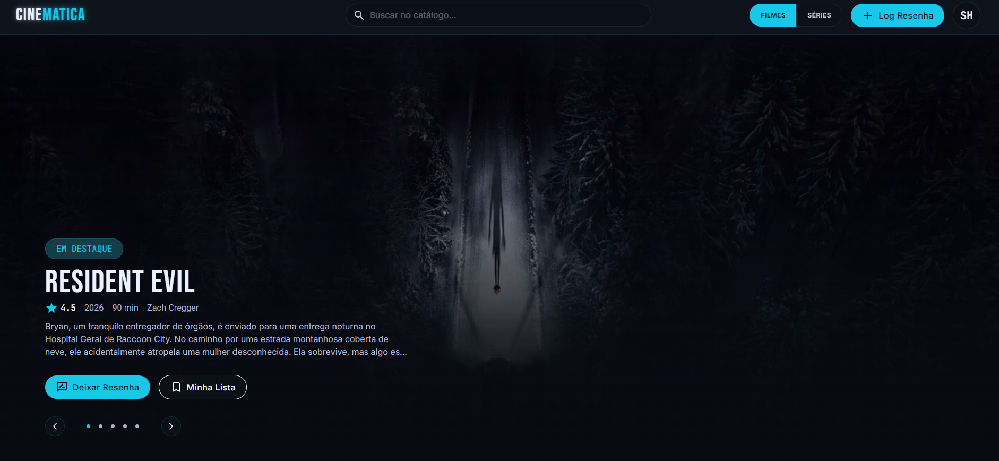

  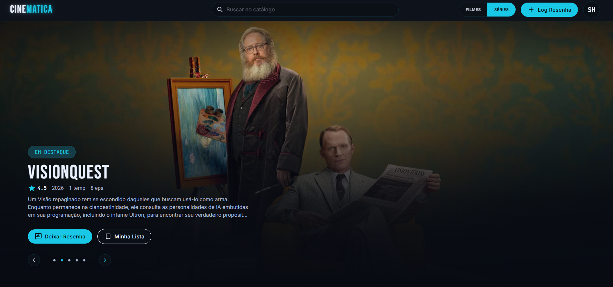

### Telas e funcionalidades

  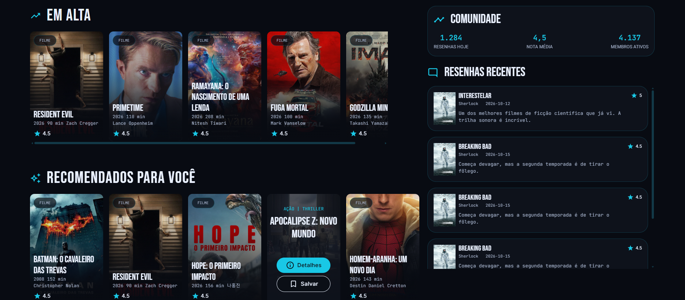

  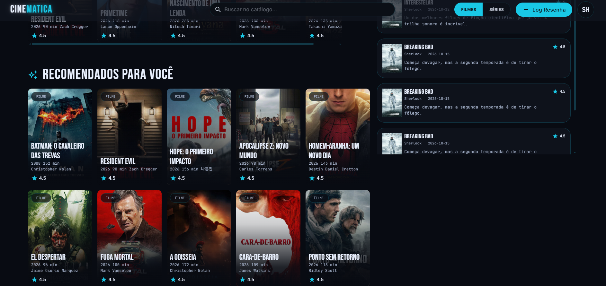

  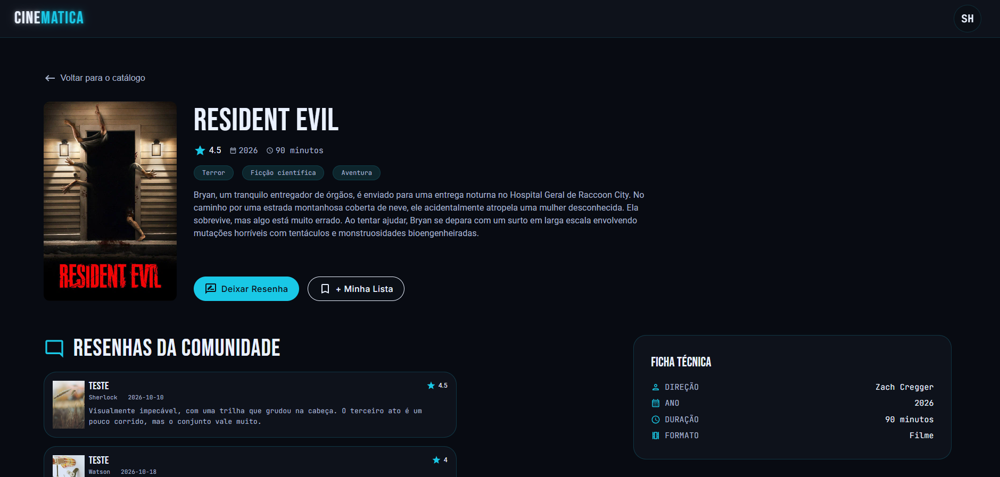

  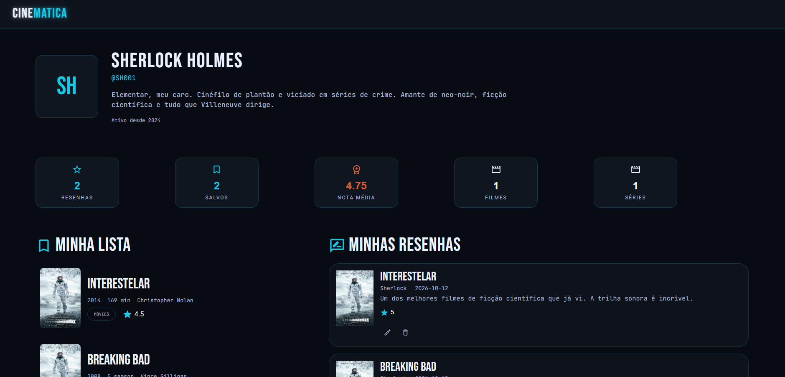

  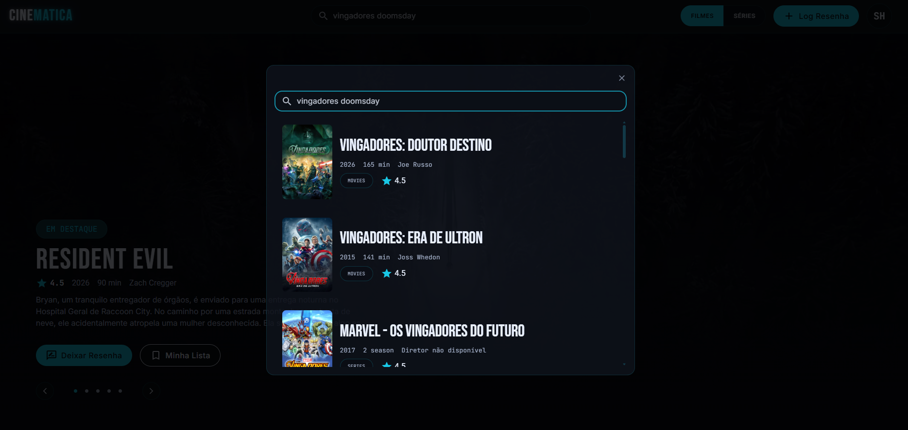

  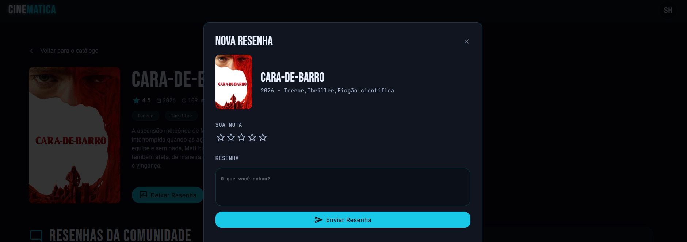

  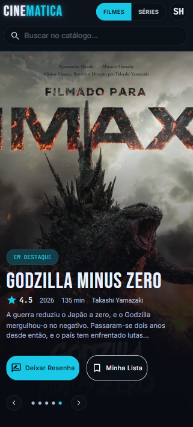

  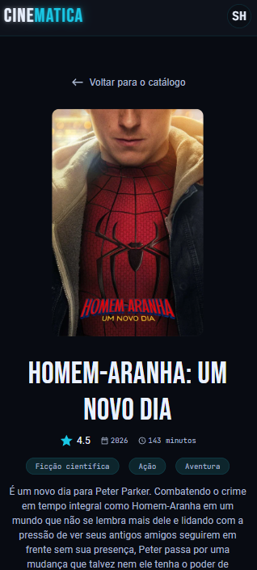

  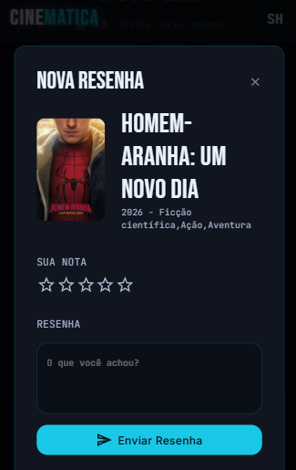

## 🛠️ Tecnologias utilizadas

| Tecnologia | Aplicação |
|---|---|
| **React** | Construção da interface e componentes reutilizáveis |
| **TypeScript** | Tipagem estática e maior previsibilidade do código |
| **Sass (SCSS)** | Estilização e organização dos estilos |
| **Material UI** | Componentes e elementos de interface |
| **TMDB API** | Consulta de informações sobre filmes e séries |
| **Node.js** | Back-end planejado |
| **PostgreSQL** | Banco de dados relacional planejado |

## 🏗️ Desenvolvimento

O desenvolvimento do Cinemática envolve decisões de interface, organização de componentes, integração com serviços externos e planejamento de uma arquitetura full-stack.

O design e a implementação do front-end foram realizados majoritariamente de forma manual, com atenção à identidade visual, organização dos componentes e experiência de navegação.

## 🚧 Status do projeto

**Em desenvolvimento.**

O front-end está concluído. As próximas etapas envolvem:

- [ ] Implementação do back-end com Node.js.
- [ ] Modelagem e integração do banco de dados PostgreSQL.
- [ ] Implementação da autenticação e persistência dos dados dos usuários.
- [ ] Integração das funcionalidades da interface com o back-end.
- [ ] Testes e disponibilização da versão beta.

---

  Desenvolvido como projeto pessoal de aprendizado e aplicação prática de desenvolvimento web.

